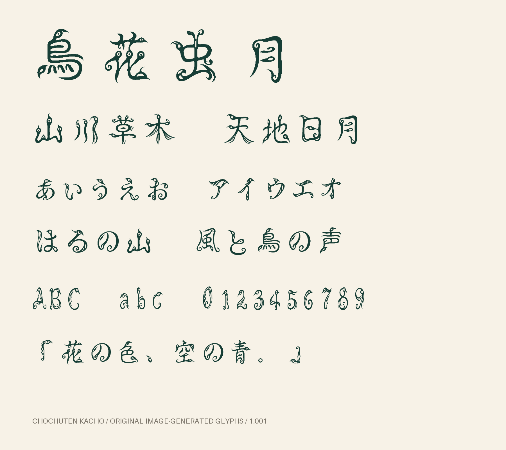

# 鳥虫篆 花鳥 — Chochuten Kacho 1.001

鳥の嘴・目・尾と虫のような曲線を筆画に織り込んだ、和文の装飾用アウトラインフォントです。古代字形の厳密な復刻ではなく、鳥虫篆を題材にした創作書体です。

ライセンスは **CC0 1.0 Universal** です。フォント・元画像・独自ソースコードに適用します。[ライセンス全文](LICENSE)を同梱しています。依存ライブラリにはそれぞれのライセンスが適用されます。

## 完成ファイル

- `output/ChochutenKacho-Regular.ttf` — TrueTypeアウトライン。
- `output/ChochutenKacho-Regular.otf` — CFFアウトライン。拡張子を変えただけのファイルではありません。
- `output/specimen.png` — 実際の完成フォントによる使用見本。
- `output/specimen.html` — 最新フォントを直接埋め込んだ、横組みの試し打ち・全文字一覧・縦組み約物の一覧。
- `output/specimen-vertical.png` — HarfBuzzで縦組みの置換・配置を適用した見本。
- `output/characters.txt` — 収録Unicode文字の一覧。
- `output/LICENSE.txt` — 配布フォントに適用するCC0 1.0 Universalの全文。
- `output/ChochutenKacho-v1.001.zip` — フォント・元画像・ソース・Docker構成・検証記録・ライセンスを含む配布一式。

OTF・TTF・配布ZIPはGitHubのReleasesから取得してください。Gitリポジトリには元画像・生成コード・Docker構成・見本・検証記録を収録します。

見本HTMLは完成TTFのcmap・GSUB・名前情報から収録文字、縦組み字形、件数、バージョンを取得します。一覧の全686文字と縦組み字形は、同じフォントの輪郭を同じ縮尺のSVG枠で表示するため、空白・結合濁点も省略しません。横組みの試し打ちには同じTTFを直接埋め込んでいます。生成用のHTML・CSS・JavaScriptは`scripts/templates/`にまとめ、文字サイズ操作は試し打ちだけを対象にします。

フォント一覧での名前は「鳥虫篆 花鳥」または「Chochuten Kacho」です。OTFとTTFは同じファミリーなので、通常はどちらか一方をインストールしてください。

## 収録範囲

画像生成した字形597字を元に、全角英数字等の派生対応を含め686のUnicode文字を収録しています。`.notdef`と縦組み用24字形を含むグリフ数は711です。

- 小学1年漢字80字、小学2年漢字160字、計240字すべて。
- 追加漢字48字（篆・蟲・體・龍・鳳・凰・印・章・夢など）。
- ひらがな86字、カタカナ90字。濁音・半濁音・小書き・旧かなを含みます。
- ASCII英数字・記号94字、和文約物39字。
- 全角ASCII対応、半角・全角空白、結合濁点・半濁点。

正確な対応は `sources/manifest.json` と `output/characters.txt` を参照してください。

漢字の範囲は[文部科学省の学年別漢字配当表](https://www.mext.go.jp/a_menu/shotou/cs/1320015.htm)で確認しました。

日本語は全角、ASCIIは600/1000 emです。かなの結合濁点・半濁点には、対応する合成済みかなへの`ccmp`置換を収録しました。縦方向のメトリクスと`vert`・`vrt2`置換を収録しています。「」『』（）［］｛｝〈〉《》【】：；ー〜…‥の22字は90度時計回りに回転し、「、。」の2字は形を変えず右上へ移動します。横組みでは元の字形を使用します。縦組み対応アプリで縦書きを指定してください。未収録の漢字はフォールバックフォントが必要です。

## 画像生成と字形の出所

全可視字形の元絵を、内蔵ImageGenの画像生成スキルで作成しました。既存フォントのアウトラインやレンダリングを字形素材として使用していません。

- 48字ずつ、最終約物シートのみ21字、追加漢字48字。計13シート。
- 元画像は `sources/sheets/`、実際の生成プロンプト全13本は `prompts/` に保存。
- 白黒化、微小ノイズ除去、余白測定、輪郭トレース、座標・字幅調整をコードで実施。
- 生成画像内の小書き「ゕ」「ゖ」は識別性に問題があったため、同じく画像生成した「か」「け」の輪郭を縮小して採用。
- 全角互換文字、結合濁点等は画像由来の輪郭を再利用。空白には輪郭を持たせていません。
- `.notdef`は生成済み「？」の輪郭を使用。

生成画像の配置には微小なばらつきがあるため、等分での切り出しではなく、文字間の余白から求めた境界をmanifestへ保存しています。

## Dockerで再ビルド

通常のDocker EngineまたはDocker Desktopが起動している環境で、プロジェクトのルートから実行します。

```sh
docker compose build
docker compose run --rm font
```

ビルド時にPythonと固定バージョンの依存パッケージを取得します。フォント生成の実行時は `network_mode: none` です。生成済み元画像を使用するため、再ビルドにAPIキー・画像再生成・API料金は不要です。出力先は `output/` と `qa/` です。生成・描画検証・ZIP作成はすべてDockerコンテナ内で行います。ソースと元画像はイメージへコピーし、ホストからは出力先の2ディレクトリだけをマウントします。

Linuxで出力ファイルの所有者を現在のユーザーに合わせる場合：

```sh
LOCAL_UID=$(id -u) LOCAL_GID=$(id -g) docker compose run --rm font
```

画像の再生成や差し替え後に切り出し境界を更新する場合：

```sh
docker compose run --rm -v "$PWD/sources:/work/sources" font python scripts/segment.py
docker compose build
docker compose run --rm font
```

`charset.py`は文字セットとプロンプトを初期生成するスクリプトです。実測済みmanifestを上書きするため、通常の再ビルドでは実行不要です。実行した場合は、その後に必ず`segment.py`を実行してください。

### Docker専用のビルド環境

ホスト上のローカル仮想環境 `.venv/`、依存キャッシュ `.buildcache/`、Pythonバイトコードキャッシュと、一時的に作成した実験用の環境は削除しました。以降の生成と検証にはDocker内のPythonだけを使用します。

`qa/docker-status.txt` に実行成否、`qa/docker-provenance.json` にコンテナ内のPython・依存パッケージのバージョンとフォントのSHA-256を記録します。`qa/docker-build.log` はコンテナ実行ログ、`qa/docker-image-build.log` はイメージ構築ログです。以前のローカルビルドの記録は、今回のDocker実行結果で置き換えます。

## 検証

- 両形式をFontToolsで再読込し、文字コード・漢字240字の収録・字幅・アウトライン形式を検査。
- 全可視Unicode文字を両形式からFreeTypeで描画し、空字形がないことと描画結果の一致度を検査。
- 切り出し境界へのインク接触がないことを597字すべてで検査。
- `qa/font-sheet-01.png` ～ `13.png` は完成TTFから描画した一覧。
- `qa/validation.json` にファイルサイズとSHA-256、`qa/render-validation.json` に描画検査結果を保存。
- `qa/vertical-validation.json` に、両形式の実際のHarfBuzz縦組み・横組み・vert/vrt2個別指定・二重適用防止・字形境界・縦送りの検査結果を保存。
- `qa/vertical-glyphs.png` は24字の横組みと縦組みの比較。縦組み用輪郭は、画像生成済みの元の輪郭を回転・平行移動して作成しています。
- OpenTypeの縦組み置換は[Microsoftの仕様](https://learn.microsoft.com/en-us/typography/opentype/spec/features_uz#tag-vert)に沿ったGSUB単一置換です。

字形は装飾性を優先しています。生成画像をトレースした輪郭なので、筆画・古文字の考証を保証する教育用・字典用フォントとしては想定していません。
